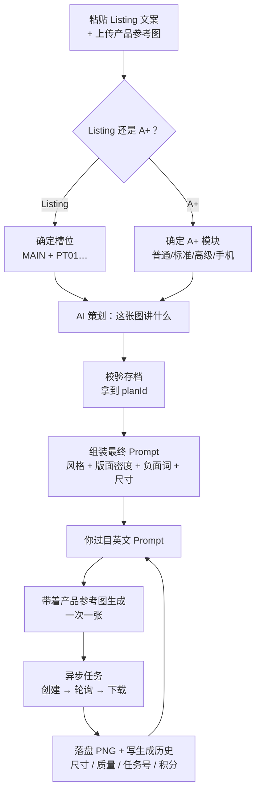
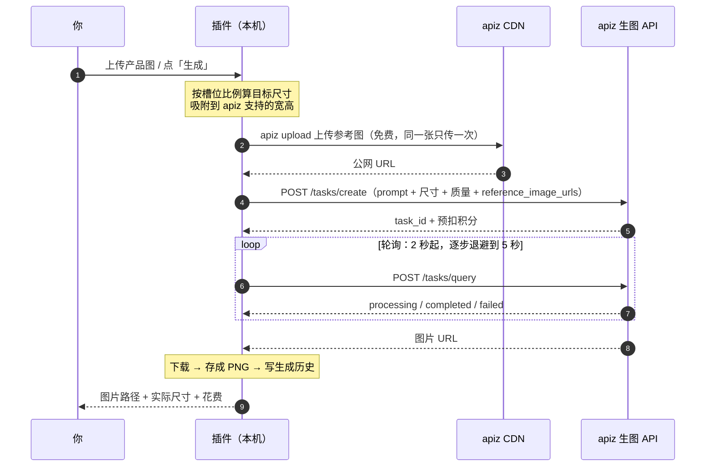

# dsh-amazon-image-studio · 亚马逊图片工作台

[](LICENSE)


DeepSeek Harness（dsh）插件：**Amazon Listing / A+ 图片 AI 策划 + 逐张生图 + 合规打标**。把粘贴的 Listing 文案策划成 `MAIN + PT01-06`（7-12 张可调）Listing 图方案或四套 A+ 模块（普通/标准/高级/手机）逐张方案——每张含中文策划说明、英文生图 Prompt、负面词；再逐槽位组装最终 Prompt、挂风格板、一次一张生成；另附 AI 人物媒体 XMP 打标工具。侧栏「亚马逊图片」面板提供策划台 / 策划档案 / 生成历史 / AI 人物打标 / 设置 / 工作流指南。

方法论与策划引擎移植自 [Ali-Aria/amazon-image-studio](https://github.com/Ali-Aria/amazon-image-studio)（MIT，上游基于 CookSleep/gpt_image_playground）。


**目录**：[它是怎么工作的](#它是怎么工作的先看这个) · [安装](#安装) · [能力清单](#装上以后有什么) · [使用](#使用) · [配置](#配置面板设置页--插件设置) · [开发](#开发) · [安全与隐私](#安全与隐私) · [许可与来源](#许可与来源)

---

## 它是怎么工作的（先看这个）

### 一句话版本

> 你把**产品图 + Listing 文案**交给插件，它先按亚马逊的图片位设计好每一张该讲什么，再把这些"意图"翻译成生图模型能听懂的英文 Prompt，最后**带着你的产品图**去 apiz 生成模型逐张出图——一次一张，出完一张落盘一张。

**核心原则：绝不让模型凭空编产品。** 每一张图都必须挂着你上传的产品实拍/包装图去生成，模型只能"改背景、加场景、加标注"，不能"改产品长什么样"。

### 整体流程



### 每一步在干什么（用保温杯举例）

| 步骤 | 工具 | 通俗解释 | 保温杯例子 |
|---|---|---|---|
| ① 查槽位 | `amz_slots` | 亚马逊的图片位是有固定含义的（主图、场景图、尺寸对比…），先把它列出来 | MAIN 主图 + PT01 保温演示 + PT02 材质特写… |
| ② 策划 | `amz_plan` | 让模型读你的文案，给每张图写"这张要证明什么" | PT01：剖面展示双层真空，标注 12 小时 |
| ③ 校验存档案 | `amz_validate_plan` | 检查张数、顺序、中英文字段是否合规，存成一个 planId | 7 张齐全 → planId `plan-xxx` |
| ④ 组装 Prompt | `amz_prompt` | 把"中文意图"翻译成生图模型听得懂的英文，并塞进风格、版面密度、禁止项、分辨率 | 生成一段英文 Prompt 给你确认 |
| ⑤ 生图 | `amz_generate` | 带着产品图去 apiz 出图，**一次一张** | 出一张 2048×2048 的 PT01 |

### 一张图的生命周期（含参考图）

这是本项目最容易让人困惑的地方：**为什么我的本地图片要先传到 apiz 的 CDN？**

答案：apiz 的图生图参数 `reference_image_urls` 只认**公网 http(s) 链接**，不认本地文件。所以插件做了一次"自动托孤"：把你的本地图用 `apiz upload` 传上 apiz 的 CDN（免费），换回一个公网链接再提交任务。



**几个必须知道的规矩：**

1. **必须带产品图。** 没有参考图（风格板不算）就不允许生成，插件会直接拒绝。这是为了保证"每张图都是你那个产品"。
   **面板里上传过的图会自动复用**：在面板产品参考图区拖过图之后，对话里直接让 agent 生图就行，不用再给路径（规则是"取最近上传的 4 张"，结果里会标 `referenceSource: panel` 并附一条提醒）；想让某张图明确生效，就在 `amz_generate` 里传 `referenceImages`。
2. **轮询超时不要重投。** 创建任务时就已经预扣积分了。超时只会报错并给你 `task_id`，正确做法是拿这个 id 去查结果（`apiz tasks get <id>`），**重新提交会二次扣费**。
3. **尺寸可能和你要求的不完全一样。** apiz 只支持固定的比例 × 档位，或一批离散的宽高。插件会挑"比例最接近、像素最接近"的那一档，历史里同时记两个值：`generationSize`（插件要的）和 `actualSize`（实际出的，比如 2048×2048）。差几个像素是正常的。
4. **主图白底、不挂风格板。** 亚马逊主图必须纯白背景、不能有道具和文字；附图/A+ 才会自动挂风格板（风格板永远是最后一张参考图，Prompt 里也写明了这条）。
5. **钱怎么算。** 按 token 实际用量：100 积分 = ¥1，创建时预扣、完成后多退少补、失败整笔退还。质量档位越高越贵（和分辨率是两件事），所以默认给最便宜的 `low`+2K，想清楚再往上调。

### 东西都存在哪

| 内容 | 位置 |
|---|---|
| 策划档案 | `${DSH_HOME}/amazon-image-studio/plans/*.json` |
| 生成的图片 | `${DSH_HOME}/amazon-image-studio/images/`（或你指定的 `outputPath`） |
| 你上传的产品参考图 | `${DSH_HOME}/amazon-image-studio/references/` |
| 生成历史（含任务号/花费/实际尺寸） | `${DSH_HOME}/amazon-image-studio/history.json` |

`DSH_HOME` 默认是 `~/.dsh`（Windows 下 `C:\Users\<你>\.dsh`）。想清理直接删对应目录即可，插件不会写到别处。

### 常见问题

**Q：为什么不给参考图就不让生成？**
因为生图模型没见过你的产品，没参考图它就会"编"一个长得像但不对的东西——这在亚马逊是硬伤（买家收到的不一样，退货+差评）。所以插件把参考图做成了硬门槛。

**Q：我传了 2K，为什么出来的不是 2K 整？**
apiz 只支持固定比例 × 1K/2K/4K，或一批离散宽高。插件会选"比例最接近、像素最接近"的那一档，所以 `actualSize` 可能和 `generationSize` 差一点。这不影响上传，亚马逊会自己缩放。

**Q：提示"轮询超时"但图没出来，钱是不是白花了？**
任务可能还在跑。**不要重新点生成**，拿报错里的 `task_id` 去 `apiz tasks get <task_id>` 查；真失败了官方会整笔退还。重新提交才是真的会二次扣费。

**Q：为什么主图不让挂风格板？**
亚马逊主图要求纯白背景、无道具无文字。风格板会带背景和装饰元素，属于违规，所以 MAIN 永远只带产品参考图。

**Q：一定要 4K 吗？**
不必。Listing 图 2K 足够（2048×2048），质量档位和分辨率是两件事：档位决定"画得多细"，分辨率决定"多大张"。想省钱先把质量和档位降下来。

**Q：除了 apiz 还能用别家吗？**
面板里不能。代码里保留了火山/OpenAI/百炼的适配器（改 `imageProvider` 仍能跑），但这不是本项目的支持面，文档和验收都不覆盖。

---

## 安装

前置：dsh `>= 0.2.1-rc.2 < 0.3.0`、Node 22+。

**方式一（面板）**：侧栏「插件」→ 添加插件 → 填本地绝对路径或包名 → 安装后开启组合包。

**方式二（命令行）**：

```bash
dsh plugin  --profile web   add  https://github.com/liangdabiao/dsh-amazon-image-studio 
```

装好后侧栏会出现「亚马逊图片」入口，点进去先到**「设置」页填 apiz Key**（或勾选复用本机 `apiz auth login` 登录态），否则生图会被拒绝。

## 装上以后有什么

| 能力 | 说明 |
|---|---|
| `amz_slots` | **槽位与规格查询**（确定性）：Listing 槽位表（MAIN+PT01-N）、四套 A+ 模块编排（槽位/模块类型/官方上传尺寸/生图换算尺寸）、模块增删 |
| `amz_plan` | **AI 策划**：Listing 文案 + 参考图（≤8MiB）→ 逐张方案 JSON（严格 schema：中文策划说明 + 英文 Prompt/负面词 + 站点语言图上文案）。配了策划 Key 直接调模型（DeepSeek 官方地址自动切纯文本模式）；未配置返回完整自策划指引，由对话模型策划 |
| `amz_validate_plan` | **策划校验闸门**：agent 自策划 / 外部策划 JSON 过严格校验（槽位数量顺序、字段语言规则、A+ 模块尺寸）后存档拿 planId |
| `amz_prompt` | **最终 Prompt 组装**：图片任务 + 风格块（最高优先级，仅附图/A+，MAIN 白底不挂）+ seriesStyleGuide（低优先级）+ 版面密度 + 负面词 + 风格防复制守卫 + 期望分辨率 |
| `amz_generate` | **一次一张生图**：按槽位自动组装/挂风格板/定尺寸。默认走 **apiz 的 GPT Image 2.5 Flare**（异步任务：创建→轮询→下载；尺寸吸附到 10 比例 × 1K/2K/4K 或离散 width/height；参考图先传 apiz CDN 换公网 URL）；另备火山 Seedream / OpenAI 兼容（含 OpenRouter chat 生图）/ 阿里百炼 Qwen-Image 三个同步适配器。结果落盘并入历史（实际尺寸 / 质量档位 / task_id / 预扣积分） |
| `amz_tag_performer` | **AI 人物打标**：JPG/PNG/WebP/MP4/MOV 写入 Amazon 要求的 `contains-synthetic-performer` XMP（纯本地零网络，已打标自动跳过，单文件 ≤500MB / 批 ≤1GB） |
| `amz_history` | 策划档案 + 生图历史 list/get/remove/clear |
| `amazon-image-studio` 技能 | 策划方法论 + 合规红线 + 字段语言规则 + 生图通道兜底 + 工具优先指引 |
| 侧栏面板 | 策划台（双模式表单 + **产品参考图拖拽上传** + 风格预设色卡 + 逐槽位 Prompt 卡片：预览/复制/生成/填对话）、策划档案、生成历史、AI 人物打标（拖文件写入 + 下载）、工作流与合规指南 |

## 使用

对话里一句话：
- **「帮我给这款保温杯策划一套亚马逊 Listing 图」**——`amz_slots` 确认槽位 → `amz_plan`（或按指引自策划 + `amz_validate_plan`）→ 逐槽位 `amz_prompt` 给你过目 → `amz_generate` 一次一张
- **「出这套产品的 A+ 图，用高级A+」**——`amz_slots`（aplusType: premium）→ 策划 → 逐模块生成；Highlight Tile 的标题/正文文案单独输出
- **「这张 AI 生成的人物视频要给亚马逊，打个标」**——`amz_tag_performer` 写 XMP
- **「看看之前策划了什么」**——`amz_history`

面板里：**先到「设置」页填 apiz Key**（或用 CLI 登录态开关）→ 回「策划台」粘贴 Listing 文案 → **拖入产品参考图（必填）** →「AI 策划」→ 逐槽位卡片「预览 Prompt / 复制 / 生成 / 填进对话生图」→ 生成历史看图。

参考图的走向：面板 `/api/upload` 落盘到 `${DSH_HOME}/amazon-image-studio/references/`，生成时作为 `referenceImages` 传给 `amz_generate`；apiz 通道会把每张 data URL 用 `apiz upload` 换成公网 URL 再传给 `reference_image_urls`（**顺序保持原样**，风格板永远在最后一张，Prompt 里的风格守卫依赖这个顺序）。主图也会带产品参考图（但不带风格板）。

## 配置（面板「设置」页 / 插件设置）

> 生图只走 **apiz**。面板左侧「设置」页可以直接填 Key、改默认值——保存后写进 profile patch 并由 Loader **热生效**，不用重启。

| 配置 | 默认 | 说明 |
|---|---|---|
| imageApiKey | 空 | **apiz 的 sk- Key**。空 且没开 `imageUseApizCliAuth` → **不允许生图**（面板与工具都会拒绝） |
| imageUseApizCliAuth | false | 复用本机 `apiz auth login` 登录态（默认关，避免"没配 Key 也在花钱"） |
| imageQuality | **low** | 质量档位：low / medium / high / xhigh / max（默认最省；越高越贵，与分辨率无关） |
| imageTransparency | false | 透明背景（输出 PNG；开启时 prompt 别描述背景，亚马逊主图请保持关闭） |
| outputTier | 2K | 1K / 2K / 4K；A+ 模块按上传尺寸比例换算 |
| requireReferenceImages | **true** | **必须上传产品参考图才能生成**；关掉才能"凭空"生图（不建议） |
| imageModel | 空 | 留空用 `apiz/gpt-image-2.5-flare` |
| imageApiUrl | 空 | 留空用 `https://api.apiz.ai` |
| apizBin | 空 | apiz CLI 路径（参考图换公网 URL 用；留空走 PATH / `APIZ_BIN`） |
| timeoutSeconds | 600 | apiz 按此上限轮询，**超时不重投**（重投会重复扣费） |
| plannerApiUrl / plannerApiKey / plannerModel | deepseek / 空 / deepseek-v4-flash | AI 策划 API；**留空 Key = 对话内策划** |
| plannerApiMode | chat | chat / responses |

### 生图通道

| 通道 | 默认模型 | 说明 |
|---|---|---|
| `apiz`（唯一） | `apiz/gpt-image-2.5-flare` | 异步任务 API：`POST /api/v3/tasks/create` → 轮询 `/api/v3/tasks/query` → 下载结果。按 token 实际用量计费（创建时预扣、完成多退少补、失败整笔退还），**100 积分 = ¥1**；10 种比例 × 1K/2K/4K 或离散 width/height；五档质量；≤16 张参考图（须公网 URL，插件自动传 CDN）；可选透明背景 |
| volces / openai / aliyun | — | **兼容保留、面板已隐藏**：`imageProvider` 手改成这三家仍能跑，但不属于本插件的支持面，文档与验收不再覆盖 |

#### apiz 通道的几个要点

- **参考图是硬门槛**：没有产品参考图不允许生成（面板会拦住并跳到上传区；工具层同样拒绝）。风格板不算参考图——它只是风格，不是产品。
- **参考图必须先上公网**：apiz 只收 HTTP(S) URL，所以风格板/产品图（插件内部是 data URL）会先用 `apiz upload` 传到 apiz CDN 换 URL（免费，按内容哈希缓存，同一张只传一次；重复传入同一张图会去重）。**顺序保持原样**，风格板固定最后一张。
- **尺寸怎么来的**：插件按槽位算出目标像素（A+ 模块按官方上传尺寸 ×2.x），再在 apiz 的 width/height 枚举里挑「比例误差 ≤2%、像素最接近目标」的一对；目标比例超出 3:1 时退回 `aspect_ratio + 1K/2K/4K`。历史里同时记 `generationSize`（要的）和 `actualSize`（实出的）。
- **超时不重投**：创建任务即预扣积分。轮询超时只报错并给出 `task_id`，正确处理是 `apiz tasks get <task_id>` 取结果。
- **Key 来源可见**：`/api/status`、设置页与生图历史都记 `keySource`（config / env / apiz-cli），用 CLI 登录态时会额外提醒。

## 前置条件

- dsh >= 0.2.1-rc.2，Node 22+
- AI 策划：策划 API Key（可选；不配则对话内策划）
- 生图：apiz 可用三种认证之一（插件 imageApiKey / `APIZ_API_KEY` / `apiz auth login`）；其余服务商需自带 Key
- apiz 通道想用参考图（附图 / A+）：本机需装 apiz CLI（`apiz upload` 换公网 URL）

## 开发

```bash
npm test          # 45 个离线单测（含 mock 策划/生图 API 全链路、apiz 异步任务、尺寸吸附）
npm run selftest  # 随包资产 / skill provider / 引擎关键路径自检
npm run api-test  # 把 registerApi 挂到本地 http 服务，真实 fetch 打全部接口（56 项）
npm run client-smoke  # 客户端模块冒烟：模块加载器 / 两个 slot / 主题订阅
npm run verify    # 上面四件套一起跑
node scripts/apiz-live-test.mjs --yes  # 真机冒烟（1024² + low，约 19 积分；不加 --yes 不执行）
npm run sandbox   # 隔离沙盒起真宿主（/tmp 或 %TEMP% 下 dsh-smoke-home）
```

> 单测与验收脚本都会把 `APIZ_API_KEY` / `APIZ_CONFIG` / `APIZ_BIN` 指到不存在的路径：否则「未配置 Key」的用例会真的打到生产接口（踩过一次）。

沙盒起来后浏览器打开终端里的地址（带 token），点侧栏「亚马逊图片」验收面板；面板 API 可 `curl`（带 URL token）。

## 安全与隐私

- API Key 只存在本机 dsh 配置 / 环境变量 / apiz CLI 配置里；面板状态接口对 Key 脱敏展示，只暴露来源（`keySource`）。
- 参考图会被上传到 apiz 的 CDN（apiz 图生图只收公网 URL）——这是 apiz 通道的必然后果，介意的话用 `volces` / `openai` / `aliyun` 通道。
- 打标工具完全本地处理，不上传任何文件。
- 生图/策划直接连你配置的服务商，插件不经手不缓存 Prompt 之外的数据。

## 许可与来源

本项目以 MIT License 发布（见 LICENSE）。策划引擎、Prompt 模板、风格预设与合规知识移植自 MIT 许可的 [Ali-Aria/amazon-image-studio](https://github.com/Ali-Aria/amazon-image-studio)（上游：[CookSleep/gpt_image_playground](https://github.com/CookSleep/gpt_image_playground)）；本插件为 dsh 插件形态的移植重构，保留上游署名。


特别感谢 https://linux.do 社区支持。
